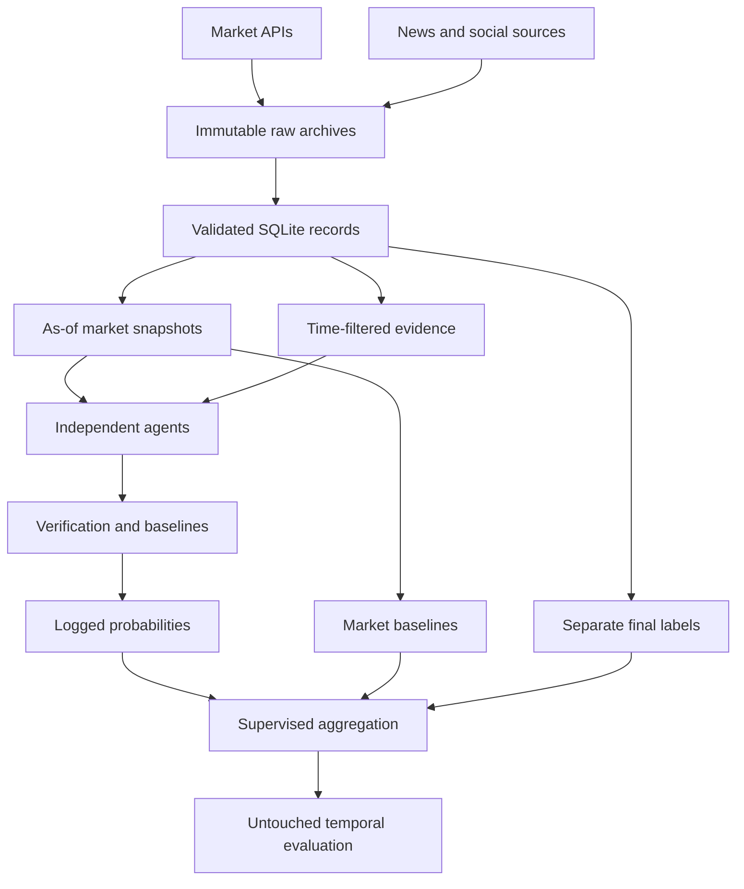

# Critical feasibility assessment and implementation framework

Prepared 27 October 2026 from the attached HX2605 planning report and current documentation.
This is an engineering/research design assessment, not a promise of a grade or a prediction of positive results.

## Feasibility judgment

The scoped project is feasible for a two-person FYP. Building a convincing **incremental-value experiment**
is harder than constructing an agent demo. Your report already chooses sensible outputs: probability
forecasts, Brier score, log loss, calibration and a non-trading demonstration. Its weakest assumptions are
historical data availability, contamination-free retrospective inference, sample size and the novelty claim.

The original ten-week plan leaves too little contingency for these risks. Being at Week 7 with no completed
pipeline means the original schedule has slipped; software generation cannot recover elapsed observation time,
paid-model access, supervisor review or outcomes that have not happened. The correct recovery is to build and
validate the infrastructure now, start prospective collection immediately, and agree a narrowed empirical
scope. Do not broaden into more agents before the clean baseline experiment works.

| Area | Assessment | Consequence |
|---|---|---|
| Public market metadata and present quotes | Technically practical; API formats/access vary | Run a small real pilot before committing to a dataset |
| Historical point-in-time evidence | High risk | A dated article fetched today may contain later edits |
| Historical LLM forecasts | High contamination risk | Model weights may already encode the outcome |
| News retrieval | Practical for prospective collection | Archive the exact content version and first observation |
| Social evidence | Conditional | Access, manipulation, bot activity, missing coverage and licenses complicate interpretation |
| Agent inference | Practical with accessible model and budget | Start with fixed roles and one verification round |
| Small supervised aggregation model | Practical once enough labels mature | Avoid fitting many parameters to a handful of independent events |
| Demonstrating superiority over market | Unknown research outcome | A rigorous null result is still a valid research contribution |
| High-quality report | Under your control | Traceability, sound comparisons and candid limitations matter |

## Sharpen the contribution

The project should ask: **Does a time-restricted, retrieval-grounded multi-agent signal improve probabilistic
forecasting beyond contemporaneous market prices and comparably resourced single-agent systems?**

Retrieval-augmented LLM forecasting and forecast aggregation already exist. Halawi et al. study retrieval,
reasoning and aggregation; ForecastBench uses unresolved future questions to avoid contamination; Hindcast
is closely related to historical prediction-market replay. Therefore, do not state that no reproducible
forecasting methodology exists. Narrow your claim to the particular controlled comparison you actually run.
See `references.md` for primary sources. A focused replication plus a carefully justified extension is more
defensible than an unsupported claim to be the first general framework.

Three separable questions must be answered:

1. Does retrieval add useful information compared with the same model without retrieval?
2. Does specialization/verification add value compared with a single agent given the same information and a comparable call/token budget?
3. Does the resulting AI signal improve on both the raw market and a recalibrated market-feature model?

The current implementation measures all three. It does not assume the answer is yes.

## Architecture and data flow

The label branch is accessible to training/evaluation only. The agent context is built from an explicit
allowlist: question, rules, cutoff and eligible evidence. Neither the eventual label nor current market price
is sent to the independent agents. Market prices enter the statistical baseline/aggregation stage instead.
This makes the contribution of the AI signal more interpretable and reduces anchoring.

### What one observation means

One supervised row is a **specific market contract at a specific forecast cutoff**, not an article or a trade.
For example, a contract may have forecasts at seven days and one day before its scheduled deadline.
Those two rows share the same eventual outcome. Other contracts about the same underlying event are also
correlated. Neither is an independent extra experiment.

The database stores a platform event group. Before the final experiment, manually inspect whether several
platform events refer to the same underlying real-world event. Merge their groups through the configured
mapping before collection/import. The bootstrap cannot correct groups that were defined too narrowly.

### Time discipline

Use UTC epoch seconds internally. Keep publication, first availability, local observation, forecast cutoff,
forecast generation, scheduled deadline, resolution and label availability separate. A news headline may
be published on Monday and first collected on Wednesday. In prospective mode, it is Wednesday evidence.
An archived Monday version can qualify for Monday replay only if its version and timestamp are verified.

The system never interpolates using a future price. It chooses a preceding price, rejects excessive age,
and excludes settlement points. The scheduled horizon uses the deadline visible at that time, not the
event's eventual settlement timestamp. Late resolution does not move the forecast cutoff retrospectively.

### Why a database plus files

SQLite stores relationships and precise as-of queries. Raw JSON preserves provider responses for audits.
CSV manifests make a frozen experiment reviewable without the application. Model artifacts contain fitted
parameters; cached LLM responses preserve the exact forecasts originally produced.

SQLite is appropriate for one scheduled writer with readers on one machine. Put the database on local disk,
not an unreliable shared network filesystem. Use PostgreSQL if you genuinely need concurrent writers across
machines. A vector database, Kafka, Kubernetes and a separate web backend are unnecessary for this scope.

## Retrieval design

The first implementation uses stateless hashed text vectors. This is deliberately simpler than a learned
dense embedding service: no API cost, no extra GPU, no fitted vocabulary/IDF using future articles. It filters
documents by availability first, then scores query similarity, deduplicates exact content and caps each source.

This is a sparse RAG baseline, not a claim that semantic retrieval has been optimized. Inspect a sample of
retrieval packets manually. Measure relevance, correct event matching, number of sources and coverage.
A dense encoder can be a later controlled replacement if the sparse method demonstrably misses relevant
evidence. Do not add it merely to increase the number of technologies in the report.

RSS records may contain summaries; GDELT records here are headlines. They are labelled as such. The code
does not pretend to possess full articles. No heuristic upgrades a current article into historical evidence.

Financial releases enter as timestamped release-vintage records through `external.py`; revised economic
values downloaded today must not be represented as the numbers originally released. Domain-specific price
feed engineering is optional until a selected market category actually needs it.

## Agents and fair baselines

| Component | Input | Output | What it tests |
|---|---|---|---|
| News agent | Rules and eligible evidence | Probability, citations, brief justification | Evidence interpretation |
| Base-rate agent | Rules only | Cautious reference-class estimate | Complementary reasoning; not an independent empirical base-rate dataset |
| Unverified ensemble | Two independent outputs | Arithmetic mean | Benefit before verification |
| Verifier | Drafts plus the same evidence | Revised probability, citations, flags | Whether scrutiny helps or introduces correlated errors |
| No-retrieval agent | Rules only | Probability | A basic LLM baseline |
| Single RAG agent | Same evidence budget | Probability | Whether agents are necessary |
| Single agent repeated K times | Same question/evidence, K calls | Mean probability | Extra computation versus specialization |
| No-social ensemble | News/external evidence only | Verified probability | Social-data contribution where coverage exists |

At temperature zero, repeated calls may be identical. This is an empirical observation, not a reason to
manufacture diversity. Record tokens and runtime; equal call counts do not imply equal cost. The verification
prompt is an auditor, not a guaranteed truth oracle. A valid citation ID only establishes that a document
exists; human checks must still determine whether the cited passage supports the claim.

The base-rate agent can hallucinate rates. Its prompt forbids invented numerical statistics, and the
no-evidence flags should be inspected. Do not market its output as a verified population frequency.

## What is trained

The LLM is used pretrained. Training a foundation model from scratch is out of scope. You do not need to
fine-tune an LLM to make this an AI engineering/research project: temporal data construction, controlled
agent experiments, supervised aggregation and valid evaluation are substantive work.

The primary trainable model is regularized logistic regression:

`p_final = sigmoid(intercept + market terms + coefficient * logit(agent probability))`.

Six fitted logistic models compare market recalibration, market features and different agent variants.
Features include market log odds, prior price movement, spread, availability flags, log volume/liquidity and
horizon. Scaling is fitted on training data only. Hyperparameters are selected using validation Brier score.
Then the chosen model is refitted on train plus validation, using only labels known by the final fit time.
Test labels are never used for feature scaling, hyperparameter selection or coefficient fitting.

The additional Bayesian correction is:

`logit(p_final) = logit(p_market) + beta_0 + beta_1*(logit(p_verified)-logit(p_market))`.

Normal priors shrink both coefficients toward zero, which returns the market forecast. MAP estimation
uses SciPy; a Hessian gives a Laplace covariance approximation. Because the likelihood uses event-balancing
weights, these are **working-likelihood posterior intervals**, not exact hierarchical Bayesian uncertainty
and not certified calibration intervals. This sensitivity model must not be oversold.

“Calibration” means forecast frequencies agree with outcomes over many cases. One successful prediction
does not prove calibration. Combining forecasts is stacking/aggregation; it is not automatically Bayesian.
The implementation names those distinctions explicitly.

## Training sequence and leakage controls

1. Choose a pilot scope, collect records and inspect data quality.
2. Fix agent prompts, model version, retrieval rules, horizons, filters and intended comparisons.
3. Choose chronological train, validation and test periods, allowing for label maturity.
4. Generate forecasts with eligible evidence and an admissible model. Store every successful output.
5. Purge event groups spanning split boundaries. Purge groups whose labels are not known by the fit time.
6. Fit/tune only on train/validation. The same complete-case rows are used across the fitted comparisons.
7. Freeze the final model before test forecasting for a prospective claim; otherwise label replay appropriately.
8. Evaluate an untouched test cohort when its outcomes resolve. Report unresolved cases and failed calls.

The included `cv.py` offers purged expanding windows. The default training command uses one explicit temporal
train/validation split, keeping the first experiment understandable. Additional walk-forward robustness
analyses are a later experiment and must not silently replace the primary protocol.

The configured minimums of 30 training groups and 10 validation groups are failure guards, not a power
calculation or proof of adequate sample size. Several hundred forecast rows can correspond to very few
independent events. Estimate detectable effect sizes from the pilot's paired event-level losses, and expand
the collection period or narrow the conclusion if uncertainty remains large.

## Historical versus prospective evaluation

An “as of date” prompt does not erase model knowledge. Even perfect date-filtered retrieval cannot remove
answers already learned in pretraining. For a retrospective LLM experiment, use a genuinely frozen model
whose weights predate the target forecast dates, document its provenance, and restrict evidence to verified
archives. A vendor's stated knowledge cutoff is imperfect evidence; a dated frozen checkpoint is stronger.

The default real run refuses stale cutoffs. Explicit retrospective mode requires a stated model freeze date
before the cutoff, but software cannot verify that the statement is true. The report must acknowledge that
trust boundary. Prospective forecasts stored before the outcome is knowable are the strongest practical
route. They require calendar time, so begin collection early rather than waiting for all model work to finish.

Collect enough early resolved events to train the aggregator before the final prospective period. You may
run fixed, untrained baselines during data accumulation. Do not fit a model after test outcomes are known
and then describe it as a model deployed beforehand.

## Evaluation and interpretation

Primary score: event-balanced Brier score. Lower is better. Log loss penalizes confident mistakes more
strongly; the clipping epsilon is fixed in configuration. Calibration curves use a modest fixed bin count
and report bin counts. Small bins are noisy; visual closeness to the diagonal is not proof of superiority.

Paired comparisons are made on the same snapshots. Losses are averaged within market and then event;
bootstrap resampling operates on event groups, preserving within-event dependence. Cross-event correlations
can remain, so also examine domain/time sensitivity. Secondary comparisons are exploratory unless a
multiple-testing policy is predeclared. No automatic p-value or causal superiority claim is generated.

The report exposes successful-call coverage and a separately scored deployed policy that falls back to
market probability when AI output fails. This prevents silent dropping of difficult failed cases from the
headline operational comparison. A common-complete-case table is also provided for architecture comparisons.

Potentially valuable negative results include: verification worsens overconfidence; retrieval helps only when
relevant evidence exists; market recalibration explains the hybrid's improvement; or a three-call single-agent
ensemble matches specialized agents. Report them honestly instead of tuning the test set until they disappear.

## Resources, cost and recovery priorities

The default real experiment runs sequentially on CPU. A normal laptop or CUHK server should handle this scale
of SQLite, sparse retrieval and small regressions; exact throughput depends on document volume and storage.
Hosted LLM inference does not require a local GPU. A local open-weight model may, depending on model size.

The complete comparison set makes about nine distinct calls per snapshot with K=3 and shared cached outputs.
For N=500 snapshots this is about 4,500 calls, before failures/retries or additional model versions.
Price the measured prompt/output tokens at your chosen provider's current rates before scaling.
Start with a three-snapshot pilot and explicitly raise the run call limit after measuring costs.

Most valuable immediate work: verify live access, select the scope, check evidence packets, start collection,
obtain model access, agree the data/evaluation plan with the supervisor, and accumulate legitimate forecast-label
pairs. A dashboard, dense vectors, fine-tuning, many agents and broad social scraping should not delay that path.
